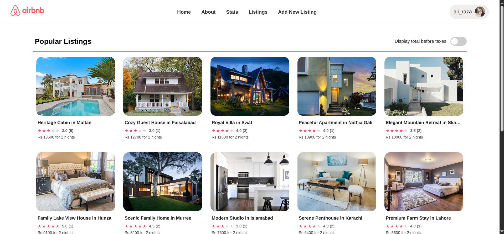
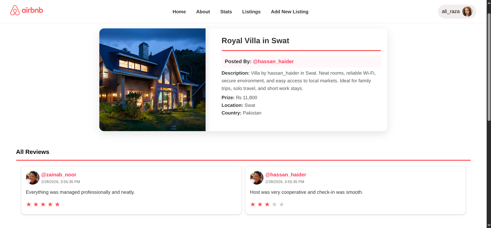
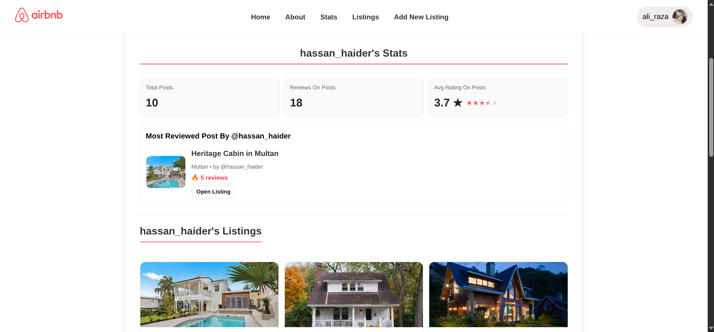

# Wanderlust

Wanderlust is a full-stack listing platform where users can explore places, post listings, leave reviews, and manage profile activity.

## Overview

- Authentication (register, login, logout)
- Listing management (create, edit, view, delete)
- Review and rating system
- User profile with personal posting stats
- Location map integration on listing details

## Tech Stack

- Node.js + Express.js
- MongoDB + Mongoose
- EJS + ejs-mate
- Passport.js (local strategy)
- Multer + Cloudinary

## Run Locally

### 1) Install

```bash
npm install
```

### 2) Environment Variables (`.env`)

```env
ATLAS_URI=your_mongodb_connection_string
SCREAT=your_session_secret
NODE_ENV=development
```

### 3) Start Server

```bash
npm run dev
```

### 4) Seed Database (optional)

```bash
npm run seed
```

## Live Link

Update after deploy:

**Live App:** [https://wanderlust.vercel.app](https://wanderlust-imeer.vercel.app/)

## Health Endpoint

Use this after deployment:

- `GET /health`

It returns runtime + DB status JSON.

## Desktop Preview (2 Rows)

<table>
	<tr>
		<td align="center"></td>
		<td align="center"></td>
	</tr>
	<tr>
		<td align="center"></td>
		<td align="center"></td>
	</tr>
</table>

---

Built by imeer.ai

## Redesign and Security Notes

Pages: Home, Stays (real filters, sort, pagination), Listing detail (booking calendar, reviews, map), Wishlist, Log in, Sign up, Profile (trips, listings), Stats, About, New/Edit listing, and friendly error pages. Light and dark theme, one font (Figtree), prices per night with a GST (18%) switch.

Security in this project (no new environment variables are needed):

- Helmet with a per-request nonce Content-Security-Policy, no inline event handlers, HSTS in production
- CSRF token on every non-GET request (`x-csrf-token` header for Postman, or `GET /csrf-token`)
- Rate limits: global, login/sign-up (10 failed tries per 15 min), and writes; accounts lock for 15 min after 8 wrong passwords
- Input checks on the server for every form (Joi / custom rules), Mongo operator stripping, HTTP parameter pollution guard, body size limits
- Passwords need 8+ characters with letters, a number and a symbol; email or password changes and account deletion ask for the current password
- Uploads: JPG, PNG or WebP only, 5 MB max; rejected or replaced photos are removed from Cloudinary
- Logout is POST only; post-login redirects are same-site only; owner checks on edit/delete; users cannot review or book their own listing
- Bookings: server-side overlap check and price calculation
- Errors never show stack traces; browsers get an error page, Postman/curl get JSON (`{ ok, status, error }`)

### Postman tips

1. `GET /csrf-token` (keep the cookie), then send the token as `x-csrf-token` on POST/PUT/DELETE.
2. Send `Accept: application/json` to get JSON responses.
3. After logging in the session id changes; call `GET /csrf-token` again.

## SEO
Every public page has a canonical URL, Open Graph/Twitter tags and (home, listing) JSON-LD. `/robots.txt` and `/sitemap.xml` are generated. Profile, wishlist, login/register and listing forms are `noindex`. Set `SITE_URL` (e.g. `https://your-domain.com`) in the environment to pin the canonical host; otherwise the request host is used.
